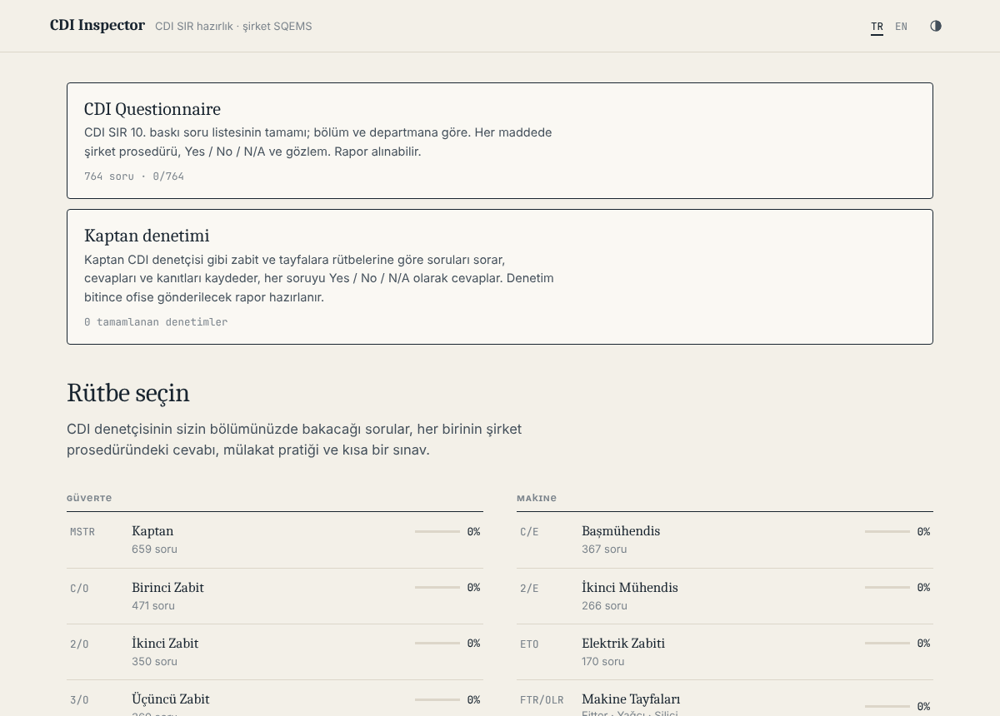
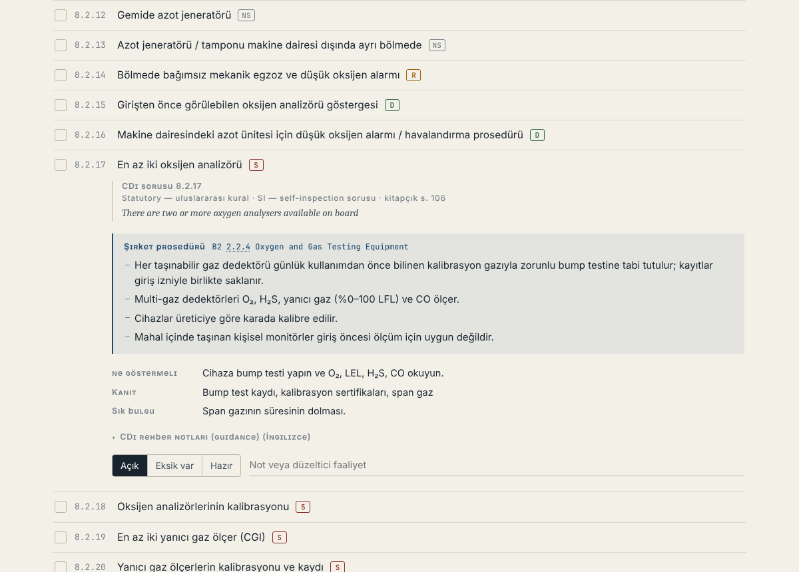
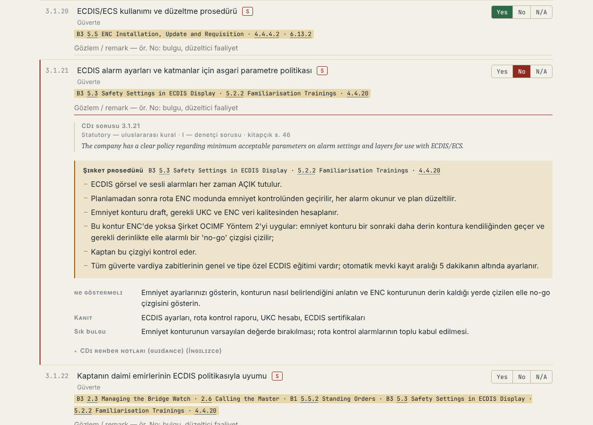

# CDI Inspector

CDI Ship Inspection Report (SIR) 10th Edition preparation by rank, with answers from the company's SQEMS procedures.
No installation and no internet needed: open `index.html` in a browser.

An adaptation of [Vetting Inspector](https://github.com/kaptanoguz/VettingInspector) (SIRE 2.0) for CDI inspections of chemical and product tankers: the full CDI questionnaire by rank, the company procedure for every question, the CDI guidance notes, interview practice, an exam, the Master's internal inspection and a printable report. Offline web app, Turkish and English interface.

## Contents
- **764 CDI questions** from the Core Questionnaire (sections 1–4 and 6–14), with the official statement (English), category **S / R / D / NS**, group **SI / I**, the booklet page and the CDI guidance notes. Questions only for gas carriers or dry bulk vessels (IGC Code, IMSBC, Grain and Timber Codes, cargo holds) are left out.
- **Section 5 (Chemical / Product cargo)** comes from the separate type-specific booklets and is added when they are imported.
- For every question: a Turkish title, the ranks it concerns and the **company procedure** that answers it (manual book and section, e.g. `B3 §5.3`), with what to show, evidence and common findings. The company procedures are the same SQEMS texts as in Vetting Inspector (B1–B7, MSMP), linked to each CDI question by hand.
- 728 questions have a company procedure. Most reuse the Vetting Inspector procedures; the rest are written for CDI from the same manuals in `js/proc/cdi.js` (company policies, Master's authority, appraisals, medical locker and first aid, hospital, asbestos, smoking, sewage, energy efficiency and SEEMP, and others). 36 have no counterpart in the manuals (EEDI / EEXI / CII / EIV values and officer knowledge of them, AED, alternative fuels, buoyage, hull markings, funnel); they show the CDI guidance notes only.
- **Crew Knowledge and Proficiency** questions (3.3, 4.2, 6.5, 7.2, 8.3, 9.2, 10.2, 11.4) are flagged: these are what the inspector asks the crew in the interview.
- **155 exam questions**, including CDI inspection rules (categories, objective evidence, SI sampling, report validity) and 82 company questions from the manuals.

## CDI Questionnaire (main menu)
- The complete question list by section, with a **Deck / Engine** filter.
- Each item shows the category badge (S red, R amber, D green, NS grey) and the company procedure reference; expanding it shows the official CDI statement, the procedure and the CDI guidance notes.
- **Manual references are clickable:** clicking the section number in a reference such as `B1 5.5.1` opens that procedure's pages as a separate PDF.
- Each item is answered the CDI way, **Yes / No / N/A**, with an **observation** field (every No needs one).
- **Report:** A4 print/PDF or Excel (CSV, `;`-separated) with ship, port, date and prepared-by details. All questions, or only No answers and observations; the department filter also applies.

## Master's inspection (main menu)
- The Master acts as the CDI inspector: enters ship, port, date, inspector and office e-mail, and selects the officers and ratings to interview (rank + name).
- Question scope: the Crew Knowledge and Proficiency questions for the rank, all questions for the rank, or a random 10. Section 1 (certification and manning) is checked from documents and is not asked.
- For each question: the CDI statement (the pocket guide question for ratings), the expected answer (company procedure) if wanted, the answer and evidence given, **Yes / No / N/A** and the observation.
- At the end, an **office report**: summary, a table per person, the No answers with observations and all questions and answers. A4 print/PDF, Excel (CSV) and a summary e-mail draft. Completed inspections are kept on the device.

## Ranks
Deck: Master · Chief Officer · Second Officer · Third Officer · Deck Ratings
Engine: Chief Engineer · Second Engineer · ETO · Engine Ratings

## How the data fits together
| File | Content |
|---|---|
| `js/cdi/core.js` | Generated from the CDI booklets by `tools/import_cdi.py`: statement, Cat, Gp, page, guidance notes. Do not edit by hand. |
| `js/cdi/map-*.js` | Written by hand, one line per CDI question: `M("3.1.21", "Turkish title", "4.1.1", "MS CO")` — the company procedure key(s) and ranks. `D("DECK")` sets the ranks for the lines that follow. |
| `js/proc/*.js` | The company procedures, written from the SQEMS manuals: `S(key, ranks, highRisk, "TR title", C("Book §section", "EN", "TR"), [EN guide], [TR guide])`. Keys are the SIRE 2.0 topic numbers they were first written for; the same text answers the matching CDI questions. |
| `js/proc/cdi.js` | Company procedures written for CDI questions that have no SIRE 2.0 counterpart, same format, keys `c-…`. |
| `js/proc/rating.js` | Rating pocket guide (21 items) from the company rating interview document. |
| `js/exam.js` | Exam: `Q(...)` general, `QC("Book §section", ...)` company question. |
| `js/manual-pages.js` | Section → manual page index for clickable references (generated). |

Rank codes: `MS CO 2O 3O DR CE 2E ETO ER`, groups `DECK ENG OFF ALL`.

## Sources (`tools/source/`, not in git)
The CDI booklets and the company manuals are confidential or copyrighted and are kept out of the repository (`.gitignore`). Copy them in locally:

| Path | Use |
|---|---|
| `cdi/CDI 10th edition Core.pdf` | CDI SIR Core Questionnaire, all vessel types (10th Edition, v10.4) |
| `cdi/` Chemical and Product booklets | Section 5 (to be added to `BOOKLETS` in `tools/import_cdi.py`) |
| `manuals/full/B1.pdf` … `B7.pdf` (+ `.txt`) | Company SQEMS manuals, the same set as in Vetting Inspector |
| `manuals/pages/` | Cut PDF of every referenced section, produced by `tools/build_manual_pages.py` |
| `manuals/MSMP_LMP_ADA.pdf` | M/T ADA Mooring System Management Plan and Line Management Plan |

The simplest way: copy the `tools/source/manuals/` folder from the Vetting Inspector working copy.

## Updating
- New CDI booklet or revision: put the PDF in `tools/source/cdi/` and run `python3 tools/import_cdi.py` (needs `pip install pdfplumber`) → regenerates `js/cdi/core.js`. New question numbers then need a line in `js/cdi/map-*.js`; the browser console warns about map lines whose question is missing from the booklet.
- Manual page links: after adding or changing a reference, or when the manuals are renewed, run `python3 tools/build_manual_pages.py` (needs Ghostscript, poppler-utils).

## Other
Themes (auto · light · dark · night red), A4 report printing, progress backup/restore, keyboard shortcuts. Progress is stored separately from Vetting Inspector, so both apps can be used on the same device.

> This is a preparation tool; the controlled SMS copy on board and the current CDI booklets are the valid ones.

## Screenshots

| Rank checklist | CDI Questionnaire |
|---|---|
|  |  |
